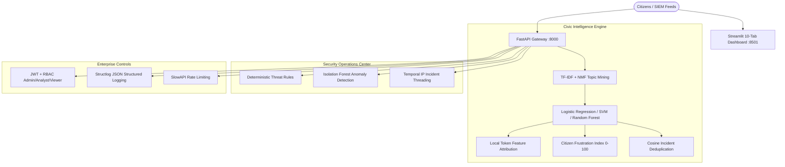

# CivicShield AI Architecture Overview

CivicShield AI unifies citizen complaint triage with cybersecurity threat operations into an integrated intelligence ecosystem.

## Core Modules
1. **CivicLens Analytics**: Automated routing, urgency escalation, SLA calculation, and geographic pressure mapping.
2. **CivicShield Security**: Event ingestion, anomaly alerts, threat clustering, and demo synthetic generator.
3. **ML Lab Pipeline**: Character + word combined n-grams, data quality assessment, and model version hashing.
